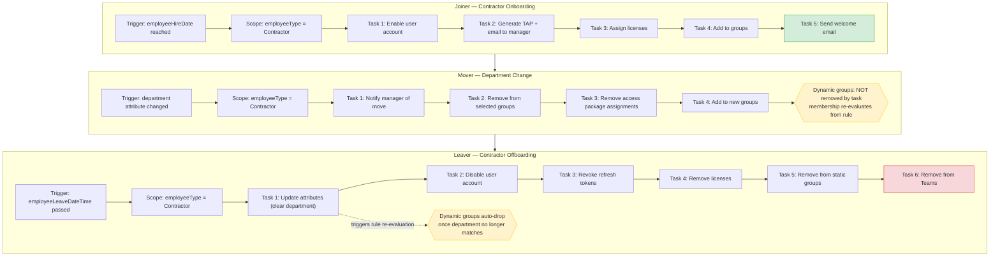

# Contractor Joiner-Mover-Leaver (JML) Automation — Microsoft Entra ID Governance

## Overview

This repository documents an end-to-end contractor identity lifecycle automation built using **Microsoft Entra ID Governance (Lifecycle Workflows)** in a sandbox/developer tenant. It covers the full Joiner → Mover → Leaver cycle, including real failure modes discovered during build-out and their fixes.

> **Note:** All tenant IDs, object IDs, and user data in this repo are placeholders. No real production data is included.

---

## Architecture



---

## Workflow Exports

Redacted JSON exports (via Microsoft Graph `GET /identityGovernance/lifecycleWorkflows/workflows`) are in [`/exports`](./exports):

| File | Workflow | Trigger |
|---|---|---|
| `joiner-workflow-redacted.json` | Contractor Onboarding | `employeeHireDate` |
| `mover-workflow-redacted.json` | Contractor Department Change | `department` attribute change |
| `leaver-workflow-redacted.json` | Contractor Offboarding | `employeeLeaveDateTime` |

---

## Failure Modes Discovered (and Root-Cause Ordering)

> *"A contractor's end date passes and nothing happens. Where did the design fail?"*

Debugged in this order, since this is how the failures actually surfaced during the build:

1. **Triggering attribute was never populated.** `employeeLeaveDateTime` defaulted to `null` — no upstream system wrote it. This is the deepest and most common real-world root cause.
2. **Scope mismatch.** `employeeType` not exactly `"Contractor"`, or blank.
3. **Workflow schedule not enabled.** The "Enable schedule" toggle must be explicitly on.
4. **Permission gap blocked attribute writes.** Updating `employeeLeaveDateTime` requires the `User-LifeCycleInfo.ReadWrite.All` Graph scope — not consentable via Graph Explorer in this tenant; resolved using PowerShell + `Connect-MgGraph -UseDeviceCode`.
5. **A task failed silently and cancelled downstream tasks.** TAP generation failed when the test user already had an Authenticator method registered, and because "Continue workflow execution on error" was disabled, every subsequent task (license, groups, email) was cancelled.
6. **Dynamic group membership was not touched by "remove from groups."** Groups with dynamic membership rules (e.g., `user.department -eq "Finance"`) are *not* affected by direct removal tasks — membership is recalculated from the rule, not assigned.

**Key takeaway:** most Leaver failures are not workflow logic bugs — they are **upstream data gaps** (missing trigger attribute) or **silent task cascades** (one failure cancels the rest).

---

## Design Correction: Mover and Dynamic Groups

**Initial (incorrect) approach:** manually clearing the `department` attribute during offboarding to force dynamic group recalculation.

**Why this is a design smell:** clearing a real attribute destroys data that other systems depend on — address book entries, other dynamic group rules, and Teams membership logic can all break if `department` is wiped rather than correctly updated.

**Corrected architecture:**
- In a real Mover event, HR/the authoritative source changes `department` to the **new legitimate value** — the dynamic rule re-evaluates on its own; no manual clearing is required.
- Access should be **derived from attributes** (dynamic groups / ABAC) wherever possible, rather than statically assigned, so Mover transitions self-correct.
- Where static assignment is unavoidable, use **access packages with expiration/time-bound assignment** (Entra Entitlement Management) so removal is built into the access grant itself, not dependent on a cleanup task remembering to run.

---

## Fail-Closed Design (vs. the Original Fail-Open Design)

**Original design flaw:** if `employeeLeaveDateTime` is never set, the Leaver workflow simply never fires — the system **fails open** (access persists indefinitely by default).

**Fail-closed redesign:**
1. **Require an end date at account creation.** No `employeeLeaveDateTime` = account should not be created, or is created in a restricted/pending state.
2. **Enforce a maximum term.** Default term (e.g., 90 days) set automatically at creation; the sponsor must explicitly renew before expiry or the account proceeds to offboarding.
3. **Use Entra's `sponsors` property.** Every contractor account has an accountable sponsor/manager for governance and audit purposes.
4. **Standing detection control.** A scheduled query/report identifies every contractor with `employeeLeaveDateTime = null`, so gaps are caught proactively rather than relying solely on the trigger firing correctly.

```powershell
# Detection query — contractors with no leave date set (run read-only against production)
Get-MgUser -Filter "employeeType eq 'Contractor'" `
  -Property Id,DisplayName,UserPrincipalName,EmployeeType,EmployeeLeaveDateTime,AccountEnabled `
  -ConsistencyLevel eventual -CountVariable count -All |
  Where-Object { $null -eq $_.EmployeeLeaveDateTime -and $_.AccountEnabled -eq $true } |
  Select-Object DisplayName,UserPrincipalName,EmployeeLeaveDateTime,AccountEnabled
```

---

## Trigger Window Limitation (Verified)

Lifecycle Workflows' time-based triggers only evaluate users whose date falls inside the current scan/evaluation window. A leave date set **retroactively in the past** was tested using "Run on demand" rather than relying solely on the automatic scheduled scan, since automatic pickup of a backdated value was not fully confirmed in this environment. **Documented limitation:** do not assume a backdated attribute value will be automatically picked up by the next scheduled scan — verify with an on-demand run or monitor the next scheduled run explicitly.

---

## Evidence Retention

Lifecycle Workflows' **Workflow history** in the Entra portal is **not a long-term audit archive** — portal retention is time-limited (verify current retention period on Microsoft Learn before relying on it for audits spanning multiple years).

**Production design:** export Workflow history and related Audit Logs to **Log Analytics / Microsoft Sentinel** via diagnostic settings, so evidence survives beyond the portal's native retention window.

**Audit completeness requirement:** when producing a leaver list for an auditor, the list must be demonstrably **complete** — i.e., it must be provably sourced from the same authoritative system of record used to trigger offboarding (the auditor's "information produced by the entity" / IPE test) — not just accurate for the records it happens to contain.

---

## Known Limitations

1. **Refresh token revocation is not instant.** Existing access tokens remain valid until natural expiry (commonly up to ~1 hour) unless Continuous Access Evaluation (CAE) applies. Disabling an account and revoking refresh tokens stops *new* token issuance and *future* refreshes, but does not instantly kill an already-issued access token outside of CAE-enabled scenarios.
2. **Device code authentication is a known phishing vector** (attacker can trick a user into approving a device code session). Acceptable for lab/admin use; in production this flow should be restricted via a Conditional Access authentication-flows condition.
3. **Disabling the Entra account does not remove local accounts in non-federated applications.** Any application with its own local identity store (not federated to Entra) can leave an orphaned account behind after offboarding — this is a downstream gap that must be tracked and remediated per-application.

---

## Tech Stack

- Microsoft Entra ID Governance (Lifecycle Workflows)
- Microsoft Graph API (`identityGovernance/lifecycleWorkflows`)
- Microsoft Graph PowerShell SDK (device-code authentication)
- Dynamic Security Groups (rule-based membership)

---

## Disclaimer

All identifiers in this repository (tenant names, object IDs, user principal names) have been replaced with placeholder values. No real organizational or personal data is included.
